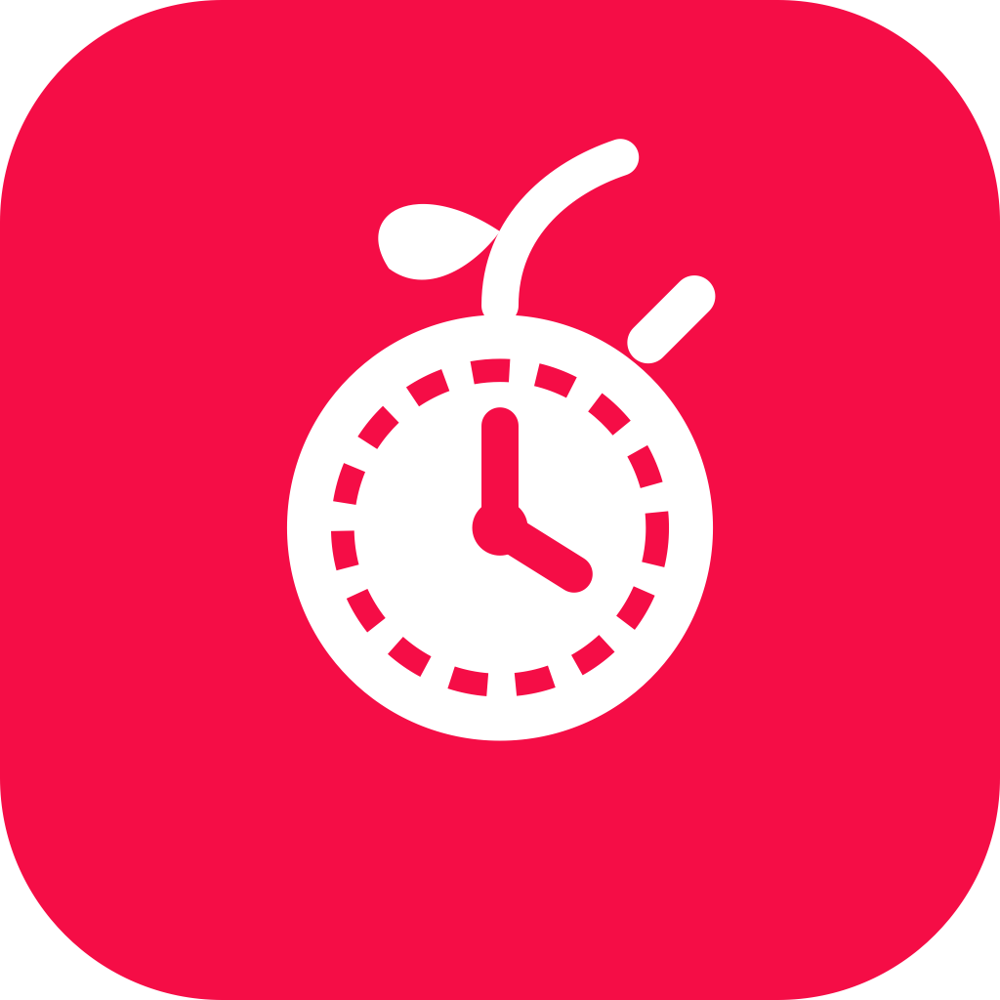

<div align="center">

# 🍒 Cherry Timer

<p align="center">
  
</p>

> A stunning, high-performance Pomodoro and Focus Timer app built with modern Jetpack Compose, circular progress visualization, and customizable intervals. ⏱️✨

</div>

---

## 📱 Overview

**Cherry Timer** is a productivity and focus companion designed with a deep obsidian OLED theme and cherry neon accents. It features Pomodoro intervals, countdown timers, stopwatch with lap tracking, procedural audio chimes, tactile haptics, and background-safe timekeeping.

---

## ✨ Key Features

- 🍅 **Pomodoro Focus & Break Modes**: Seamlessly toggle between deep focus sessions, short breaks, and long breaks with custom durations.
- ⭕ **Glowing Circular Progress Ring**: M3 Expressive timer ring with pulsing neon cherry glow and buttery-smooth progress animation.
- 🔒 **Background-Safe Timekeeping**: Coroutine timestamp delta tracking ensures reliable countdown accuracy even when backgrounded or locked.
- 📊 **Productivity Analytics & Stats**: View completed focus totals, session streaks, and focus efficiency at a glance.
- 📜 **Session History Sheet**: Comprehensive log of past focus sessions with durations, timestamps, and tags.
- 🔔 **Procedural Audio Chimes**: Built-in synthetic audio chimes generated via `AudioTrack` with zero external audio assets required.
- 📳 **Tactile Haptic Feedback**: Satisfying tactile feedback pulses for button clicks, timer completions, and mode switches.
- 📱 **Adaptive Layouts**: Responsive layout adapting from single-pane mobile screens to two-pane split layouts on foldables and tablets.

---

## 📸 Screenshots & UI Preview

| Focus Session | Short Break | Timer Settings |
| :---: | :---: | :---: |
|  |  |  |

---

## 🛠️ Tech Stack & Architecture

- **UI Toolkit**: [Jetpack Compose](https://developer.android.com/jetpack/compose) with Material 3 Expressive
- **Architecture**: MVVM with Kotlin Coroutines & `StateFlow`
- **Audio Engine**: Android `AudioTrack` procedural frequency synthesizer
- **Layouts**: Compose Adaptive layouts for large screens and foldables
- **Language**: 100% [Kotlin](https://kotlinlang.org/)

---

## 📂 Project Structure

```tree
com.asta.cherrytimer/
├── navigation/             # Navigation destinations & host
├── ui/                     # TimerScreen, circular progress ring, settings, and theme
├── util/                   # Audio chime generator, haptic manager, formatters
├── viewmodel/              # TimerViewModel, TimerUiState, session statistics
└── MainActivity.kt         # Entry point activity & lifecycle host
```

---

## 🚀 Getting Started & Build Instructions

### Prerequisites
- Android Studio Ladybug or newer
- JDK 17 or higher
- Android SDK 24+ (Target SDK 35)

### Build Steps

1. **Clone the repository**:
   ```bash
   git clone https://github.com/asta-JC/Cherry-Timer.git
   cd CherryTimer
   ```

2. **Open in Android Studio**:
   - Open Android Studio and select **Open**.
   - Navigate to the cloned `CherryTimer` directory and let Gradle sync.

3. **Build & Run**:
   - Connect an Android device or start an emulator.
   - Run the app via Android Studio or execute via terminal:
     ```bash
     ./gradlew :app:assembleDebug
     ```

4. **Run Unit Tests**:
   ```bash
   ./gradlew :app:testDebugUnitTest
   ```

---

## 📄 License

This project is developed as part of Asta's project series. Feel free to use and adapt for personal and educational use!

---

<p align="center">
  Made with ❤️ & 🍒 by Asta
</p>
