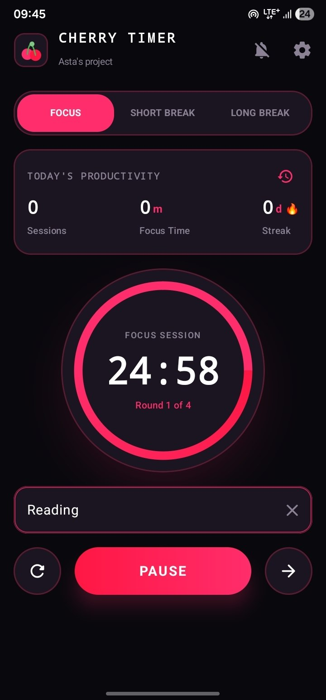
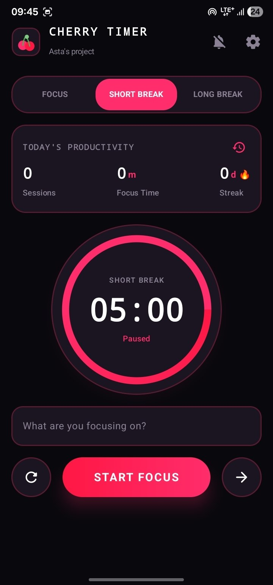
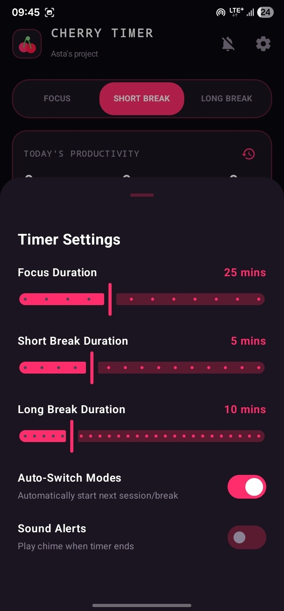

# Cherry Timer 🍒⏱️

> A stunning, high-performance Pomodoro and Focus Timer app — the spiritual sequel to **Cherry Calc**. Built with modern Jetpack Compose, Material 3 Expressive, and Navigation 3.

---

## 🎨 Design System & Theme

Cherry Timer features the signature **Cherry Dark** aesthetic, crafted for deep focus, minimal eye strain, and vibrant contrast:

| Token / Element | Hex Code / Style | Description |
|-----------------|------------------|-------------|
| **Background**  | `#09080D`        | Deep obsidian background for OLED displays |
| **Surfaces**    | `#1A1520`        | Elevated cards, sheets, and bottom navigation containers |
| **Borders**     | `#5A1A30`        | Deep crimson structural outlines and dividers |
| **Cherry Accent**| `#FF2D6B`       | Vibrant cherry pink-red neon glow for active timers and primary actions |
| **Typography**  | Material 3 Expressive | Clean, readable hierarchy with large display numerals |

---

## 📸 Screenshots

| Focus Session | Short Break | Timer Settings |
|---------------|-------------|----------------|
|  |  |  |

---

## 🚀 Core Features

- **Pomodoro Focus & Break Modes**: Easily switch between deep focus sessions, short breaks, and long breaks with customizable durations.
- **Glowing Circular Progress Ring**: Immersive M3 Expressive timer ring featuring a pulsing neon cherry glow and buttery-smooth progress animation.
- **Background-Safe Timekeeping**: Built with robust coroutine timestamp tracking to ensure accurate countdowns even when the app is backgrounded or device is locked.
- **Productivity Analytics & Stats**: Track daily completed focus totals, session streaks, and focus efficiency at a glance.
- **Session History Sheet**: Comprehensive log of completed pomodoro sessions with timestamps, durations, and session tags.
- **Interactive Settings Sheet**: Tailor focus lengths, break durations, auto-start options, and sound/haptic preferences.
- **Procedural Audio Chimes**: Built-in synthetic audio generation using `AudioTrack` — zero external audio assets required.
- **Tactile Haptic Feedback**: Satisfying haptic pulses for button interactions, timer completions, and mode switches.
- **Adaptive Two-Pane Layout**: Seamlessly adapts from single-pane mobile screens to two-pane split layouts on tablets, foldables, and desktop form factors using Compose Material Adaptive.

---

## 🛠️ Tech Stack & Architecture

- **Kotlin**: 100% Kotlin codebase utilizing Coroutines and Flow for reactive asynchronous state management.
- **Jetpack Compose**: Declarative UI built entirely with Compose and Material 3 Expressive components.
- **Navigation 3 (`androidx.navigation3`)**: Modern type-safe navigation and state-driven routing.
- **Compose Material Adaptive**: Multi-pane scaffold and window size class support for foldable and large-screen devices.
- **Audio & Haptics**: Low-level `AudioTrack` sound synthesis and Android `Vibrator` haptics.
- **Edge-to-Edge**: Fully immersive edge-to-edge UI handling system window insets seamlessly.

---

## 📱 Getting Started & Build Instructions

### Prerequisites
- **Android Studio**: Ladybug / Koala or newer (supporting Jetpack Compose and AGP 8.x).
- **JDK**: Java 17 or higher.
- **Android SDK**: API level 24 (Nougat) to 35 (Android 15+).

### Quick Build & Run
1. Clone the repository:
   ```bash
   git clone https://github.com/asta-JC/Cherry-Timer.git
   cd CherryTimer
   ```
2. Build the debug APK via Gradle:
   ```bash
   ./gradlew :app:assembleDebug
   ```
3. Run unit and instrumentation tests:
   ```bash
   ./gradlew :app:testDebugUnitTest
   ```

---

## 📄 License

This project is developed as part of Asta's project series. Feel free to use and adapt for personal and educational use!

---

<p align="center">
  Made with ❤️ & 🍒 by Asta
</p>
