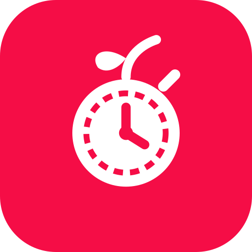
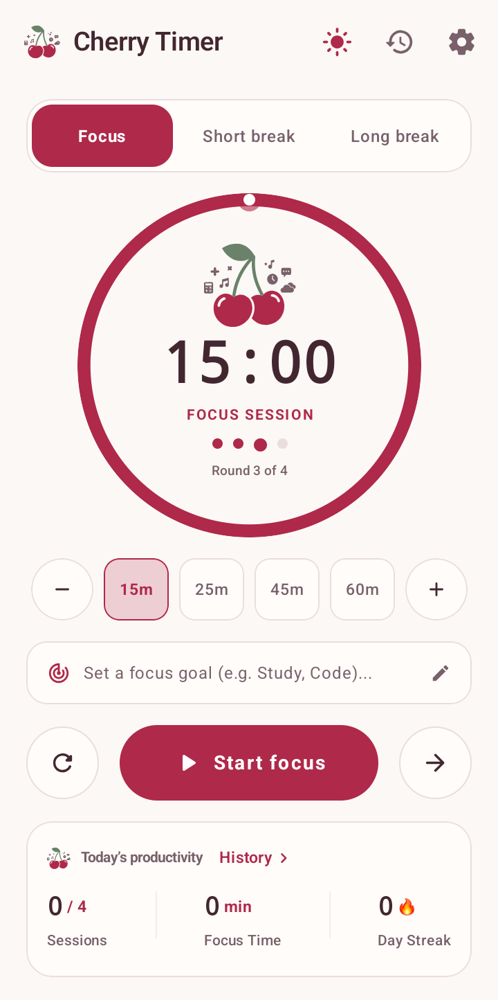
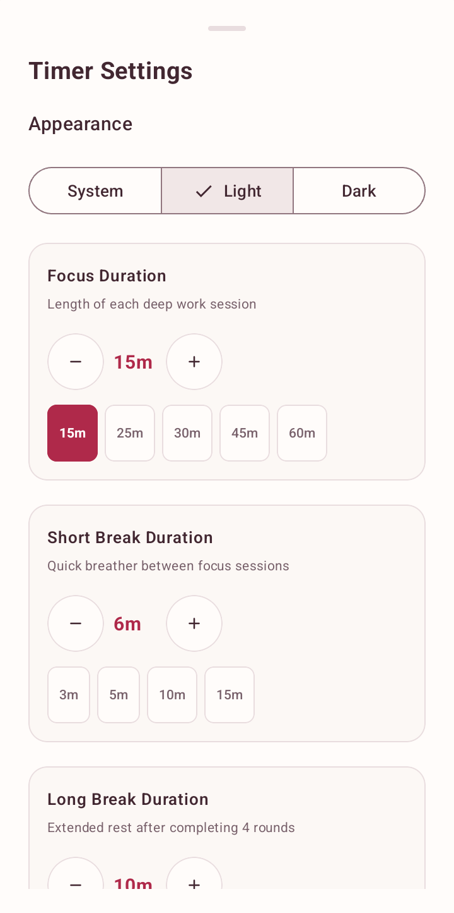

<div align="center">
  
  <h1>Cherry Timer</h1>
  <p><strong>Make room for focus and a little rest.</strong></p>
  <p>A Pomodoro timer with flexible focus sessions, breaks, and a clear view of your daily progress.</p>
  <p>
    
    
    
  </p>
  <p><a href="#screenshots">Screenshots</a> · <a href="#features">Features</a> · <a href="#getting-started">Get started</a> · <a href="https://github.com/asta-JC/Cherry-Timer/issues">Feedback</a></p>
</div>

---

## Overview

Choose a focus interval, add an optional task goal, and start the countdown. Cherry Timer keeps focus sessions and short or long breaks together, with saved preferences, session history, and daily totals to help you build a routine.

## Screenshots

<table>
  <tr><th width="33%">Timer</th><th width="33%">Focus session</th><th width="33%">Settings</th></tr>
  <tr>
    <td align="center"></td>
    <td align="center"></td>
    <td align="center"></td>
  </tr>
  <tr><td align="center">Pick your interval.</td><td align="center">Stay with one task.</td><td align="center">Set your own rhythm.</td></tr>
</table>

Captured from the real app on a Samsung Galaxy S22 Ultra (SM-S908N), in Light appearance. System bars are cropped out; the running session is a demonstration.

## Features

- **Focus and break modes:** switch between focus, short breaks, and long breaks with customizable durations and quick presets.
- **Clear timer controls:** start, pause, resume, reset, or skip an interval, with a circular progress display and round indicators.
- **Task goals:** give a session a task name and review completed focus sessions in history.
- **Daily progress:** see completed focus sessions, focus minutes, and your recorded streak.
- **Sound and haptics:** enable completion chimes, preview the sound, and optionally start the next interval automatically.
- **Saved appearance:** follow the system or choose Light or Dark, with a quick theme toggle and shared CherryApps branding.

## Compatibility

| Item | Support |
| --- | --- |
| Platform | Android 7.0 / API 24 and newer |
| Layout | Scrollable phone UI and a two-pane layout at larger widths |
| Timer persistence | Saves the target end time and restores the remaining countdown when reopened |
| Completion alerts | No foreground service or exact-alarm scheduling; alerts while the process is stopped are not guaranteed |

## Getting started

### Download

The v1.1 APK is debug/test-signed using the existing development certificate. It is intended for testing, rather than a production-signed distribution.

### Requirements

- Android Studio with support for the project's Android Gradle plugin.
- JDK 25, as selected by the Gradle daemon toolchain configuration.
- Android SDK platform 37 and a connected physical Android device for running the app.

### Build and run

```bash
git clone https://github.com/asta-JC/Cherry-Timer.git
cd Cherry-Timer
./gradlew :app:assembleDebug
adb devices
adb -s YOUR_DEVICE_SERIAL install -r app/build/outputs/apk/debug/app-debug.apk
adb -s YOUR_DEVICE_SERIAL shell am start -n com.asta.cherrytimer/.MainActivity
```

Set `sdk.dir` in your local `local.properties` if Android Studio has not already configured it. Replace `YOUR_DEVICE_SERIAL` with the physical device you intend to use. Installing with `-r` preserves app data when the installed app uses the same signing certificate.

### Tests

```bash
./gradlew :app:testDebugUnitTest :app:lintDebug
```

## Built with

| Layer | Technology |
| --- | --- |
| Language | Kotlin |
| Interface | Jetpack Compose and Material 3 |
| Navigation | Navigation 3 |
| State | Android ViewModel, StateFlow, Kotlin coroutines |
| Persistence | SharedPreferences and Kotlin serialization |
| Audio | Android AudioTrack |

## What's new in 1.1

- Shared CherryApps cream/rose and plum themes with the full header logo.
- A saved Light/Dark toggle and a System appearance option.
- Larger timer controls, scrolling presets, and improved layouts for larger text.
- The vibration permission required by the existing completion haptics.

## Feedback

Report issues or suggest improvements in [GitHub Issues](https://github.com/asta-JC/Cherry-Timer/issues). Include your Android version, device model, app version, and short steps to reproduce. Use non-sensitive examples and screenshots.

## License & credits

This project is developed as part of Asta's project series. Feel free to use and adapt for personal and educational use!

Built with Android Jetpack, Kotlin, and their open-source dependencies; their respective licenses apply.

---

<p align="center">
  <strong>Made with ❤️ &amp; 🍒 by Asta</strong><br />
  <sub>Part of the CherryApp family.</sub>
</p>
